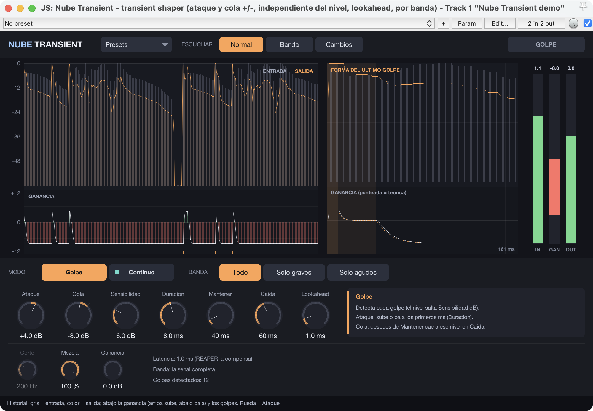

<!-- en -->
# Nube Transient

A free transient shaper for [REAPER](https://www.reaper.fm), written as a JSFX (macOS / Windows / Linux), part of the
[Nube plugins](https://github.com/KevinMeneses/nube-plugins).



**Attack** and **sustain/tail** up or down, independent of the input level (there is no threshold: it reacts to
level *jumps* and envelope *differences* in dB). Two engines: **Hit** (detects each hit; attack boost/cut for a set
duration, then hold → decay → tail level — the same math as the `claude_cola_corta` JSFX it grew from, bit for bit)
and **Continuous** (classic fast-vs-slow envelope shaper for loops, buses and pads). Optional **lookahead** with
latency compensation, **band mode** (lows only / highs only, Linkwitz-Riley 4 crossover), mix, output gain, listen to
the band or to what changes, live history with the gain lane, a "shape of the last hit" view with the theoretical
curve, IN/GAIN/OUT meters and 24 presets for trap, drill, dancehall and reggaetón. ~0.3 % CPU (Hit) / ~1 % (worst case).

**Install** — with [ReaPack](https://reapack.com): *Extensions → ReaPack → Import repositories*, paste
`https://github.com/KevinMeneses/nube-plugins/raw/main/index.xml`, then install **Nube Transient**. Or copy
`nube_transient.jsfx` into `REAPER/Effects/Nube Transient/` (on macOS `./install.sh` links it). It shows up as
**JS: Nube Transient**. The interface is in Spanish.

**How it was made** — designed and built with [Claude Code](https://claude.com/claude-code). Since an AI can't
listen, every feature is verified by rendering test cases inside REAPER and comparing them with the original JSFX
(bit-identical), with a numpy model of the algorithm (`tests/proto.py`) and with the theory (`tests/run.sh`), on
synthetic hits and on real kicks, snares, claps, hats and 808s; plus mouse-driven UI tests (`tests/ui_test.py`).

**License** — GPL-3.0-or-later (see `LICENSE`).

---

## Español
Transient shaper para REAPER (JSFX, macOS/Windows/Linux), hermano de [Nube Gate](https://github.com/KevinMeneses/nube-gate)
y [Nube Comp](https://github.com/KevinMeneses/nube-comp). Nace de `claude_cola_corta` (el JSFX que acorta el snare y el
clap de "Nube baja") y le agrega lo que traen los transient designers de pago (SPL Transient Designer, Kilohearts
Transient Shaper, el TS-1 de Native Instruments): ataque y cola en las dos direcciones, por banda y con lookahead.


- **Ataque** (−24 a +24 dB): más golpe (punch, clic) o un golpe más suave.
- **Cola** (−40 a +20 dB): más seco y corto (menos sala, menos resonancia) o más cuerpo y sostenido.
- **No depende del nivel**: no hay umbral. Reacciona a *saltos* de nivel y a *diferencias* de envolventes en dB, así
  que hace lo mismo con un snare a −1 dBFS que a −30 dBFS (medido: idéntico en Continuo; en Golpe igual en ≥ 97 % del
  tiempo, ver abajo).
- **2 modos**:
  - **Golpe**: detecta cada golpe (la envolvente rápida salta **Sensibilidad** dB sobre la lenta, igual que
    `claude_cola_corta`). El **Ataque** cubre los primeros **Duración** ms (después se apaga en un tercio de eso); la
    cola queda intacta durante **Mantener** y después llega al nivel de **Cola** en **Caída** ms. Si dentro de la
    ventana del ataque el nivel vuelve a saltar (samples con un pre-ruido antes del pico), la ventana se re-arma.
    Para pistas de golpes sueltos: kick, snare, clap, hats, 808.
  - **Continuo**: el shaper clásico. Ataque = cuánto supera el máximo reciente a una envolvente lenta (de **Duración**
    ms); Cola = cuánto cayó el nivel bajo el pico recordado (**Memoria**, la misma perilla que Caída). Las dos se
    normalizan con la **Sensibilidad** (a esa diferencia, efecto completo). Detecta con un máximo deslizante de
    15–30 ms, así que un 808 o un bajo no hacen temblar la ganancia. Para loops, buses de batería, guitarras, pads.
- **Lookahead** 0–10 ms (REAPER compensa la latencia): el Ataque no se pierde el primer ms. En Golpe los tiempos se
  corren con el lookahead, así que Mantener y Caída suenan igual con o sin él.
- **Banda**: Todo, **Solo graves** o **Solo agudos** con **Corte** de 30 Hz a 12 kHz (cruce Linkwitz-Riley de 4º orden:
  sin efecto la suma es plana). Detecta y procesa solo esa banda: el punch del kick sin tocar el clic, el crack del
  snare sin tocar el cuerpo.
- **Escuchar**: Normal, **Banda** (solo la banda procesada, para ajustar el corte) o **Cambios** (solo lo que se
  agrega o se quita: si en "Cola −" se oye el cuerpo del golpe, Mantener es muy corto).
- **Mezcla** (paralelo) y **Ganancia** de salida.
- **Medidor**: historial en vivo (entrada, salida, carril de ganancia —verde sube, rojo baja— y una marca por golpe),
  **forma del último golpe** (envolventes de entrada y salida y la ganancia medida sobre la teórica punteada), medidores
  IN / GAN / OUT con máximos, indicador **GOLPE** y contador de golpes.
- Ayuda en el pie de la ventana de todo lo que tienes bajo el mouse.

## Instalar

```sh
./install.sh
```

Crea un enlace en `~/Library/Application Support/REAPER/Effects/Nube Transient/`. En REAPER aparece como
**JS: Nube Transient** en el navegador de FX. Si cambias el código, vuelve a insertar el FX.

## Cómo se usa

| Acción | Cómo |
|---|---|
| Ataque / Cola | Perillas (el arco sale del 0) |
| En la forma del último golpe | Arrastra **arriba/abajo = Cola**, **izquierda/derecha = Mantener** (Golpe) o **Memoria** (Continuo); rueda = Ataque |
| En el historial | Rueda = Ataque; clic derecho = presets |
| Perillas | Arrastra arriba/abajo o usa la rueda; **Shift** = fino; **doble clic** = valor por defecto |
| Reiniciar máximos | Clic en los medidores |

Por defecto no hace nada (Ataque 0, Cola 0): elige un preset o mueve Ataque y Cola. Subir el ataque sube los picos:
mira el medidor OUT (o pon un Nube Clip / Nube Limit después).

## Presets

| # | Preset | Modo | Ajustes |
|---|---|---|---|
| 1 | Snare (Nube baja) | Golpe | Cola −4, Mantener 70, Caída 130 (el `claude_cola_corta` del snare: suena idéntico) |
| 2 | Clap (Nube baja) | Golpe | Cola −8, Mantener 60, Caída 100 (el del clap: idéntico) |
| 3 | Cola corta (claude_cola_corta) | Golpe | Cola −12, 40 / 60 (el original por defecto: idéntico) |
| 4 | Kick: más pegada | Golpe | Ataque +5, 12 ms, lookahead 1 |
| 5 | Kick: más corto | Golpe | Cola −12, Mantener 90, Caída 120, lookahead 2 |
| 6 | Kick: más clic (solo agudos) | Golpe | Ataque +8, 6 ms, agudos sobre 2.5 kHz |
| 7 | Kick: punch en los graves | Golpe | Ataque +4, 30 ms, graves bajo 150 Hz |
| 8 | Snare: más crack (solo agudos) | Golpe | Ataque +6, 10 ms, agudos sobre 1.5 kHz |
| 9 | Snare: más cuerpo | Golpe | Cola +4, Mantener 30, Caída 120 |
| 10 | Snare: suavizar el golpe | Golpe | Ataque −5, 8 ms |
| 11 | Clap: más chasquido | Golpe | Ataque +5, 8 ms |
| 12 | Clap: seco | Golpe | Cola −10, 45 / 70 |
| 13 | 808: más golpe al inicio | Golpe | Ataque +4, 25 ms, sensibilidad 3 |
| 14 | 808: cola más corta (drill) | Golpe | Cola −14, Mantener 200, Caída 250, sensibilidad 3 |
| 15 | 808: más sostenido | Golpe | Cola +5, Mantener 100, Caída 300, sensibilidad 3 |
| 16 | Hi-hats: más chick | Golpe | Ataque +6, 5 ms, sensibilidad 4 |
| 17 | Hi-hats: más cortos | Golpe | Cola −12, 15 / 30, sensibilidad 4 |
| 18 | Loop de batería: más pegada | Continuo | Ataque +5, Cola −2, Memoria 200 |
| 19 | Bus de batería: menos ataque | Continuo | Ataque −4, 10 ms |
| 20 | Batería: quitar la sala | Continuo | Cola −10, Memoria 300 |
| 21 | Dembow / dancehall: snare seco | Golpe | Ataque +2, Cola −8, 50 / 80 |
| 22 | Percusión: seca y con pegada | Golpe | Ataque +4, Cola −8 |
| 23 | Guitarra / pluck: suavizar el ataque | Continuo | Ataque −6, 20 ms |
| 24 | Por defecto | Golpe | sin efecto |

## Límites (medidos)

- **808 ligado**: si la nota siguiente llega con la anterior sonando fuerte, no hay salto de nivel y no cuenta como
  golpe (en las pruebas: la 2ª nota de un 808 ligado salta 0.8–2.4 dB). En Golpe con Cola negativa esa nota queda en el
  nivel de la cola. Para 808 usa sensibilidad 2–3 dB (los presets 13–15 traen 3) y revisa con el indicador GOLPE.
- **Golpe conserva el piso de −80 dBFS** de `claude_cola_corta` (para no disparar con el ruido; es lo que lo hace
  idéntico al original). Con la entrada 30 dB más baja, algún re-golpe muy débil de un clap o un 808 queda bajo ese
  piso: el 97–99 % del tiempo la ganancia es la misma (dif. < 0.1 dB). Continuo no tiene piso: idéntico a cualquier nivel.

## Pruebas

`tests/run.sh` (con el candado de REAPER compartido si hay otras sesiones):

```sh
until mkdir /tmp/nube-reaper.lock 2>/dev/null; do sleep 5; done; NUBE_PY=~/Music/ClaudeBeats/.venv/bin/python tests/run.sh; rmdir /tmp/nube-reaper.lock
```

Renderiza 77 casos en una pestaña temporal (75 chequeos) (señales sintéticas de `tests/make_signals.py` y, si está en la máquina,
la librería urbana de ClaudeBeats) y verifica:

- **Igual al original**: `claude_cola_corta` (por defecto, el snare y el clap de Nube baja, sobre golpes sintéticos,
  snare, kick, clap y 808) contra los presets 1–3 → **0 muestras distintas** (bit a bit).
- **Igual al prototipo** numpy (`tests/proto.py`) en Golpe, Continuo, bandas, escuchar, mezcla y lookahead: −150 dB.
- **Teoría**: sin efecto = intacto; ataque +6 a los 5 ms y 6/e a duración + τ; cola −12 en cada punto de la curva
  (±0.1 dB); lookahead alineado y +6 desde el primer ¼ ms; un 45 Hz fijo no hace temblar la ganancia (0.00 dB p-p);
  el cruce LR4 plano (±0.00 dB); solo graves deja intacto un 4 kHz y solo agudos los golpes de 60 Hz; mezcla 50 %.
- **Independencia del nivel** (0 vs −30 dB) en golpes sintéticos y en kick, snare, clap y 808 reales.
- **Presets** sobre samples reales: cuánto sube o baja el ataque, el cuerpo y la cola de cada golpe.

`tests/reopen.sh [preset]` abre una demo (pestaña propia, loop de batería, fader en −inf) y `tests/ui_test.py` prueba
la interfaz con el mouse (21 pruebas; mueve el mouse de verdad). `tests/perf.lua` mide la CPU.
